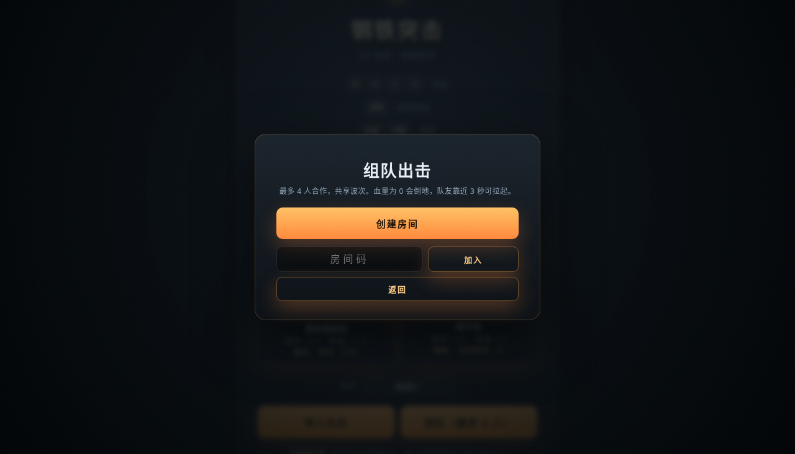
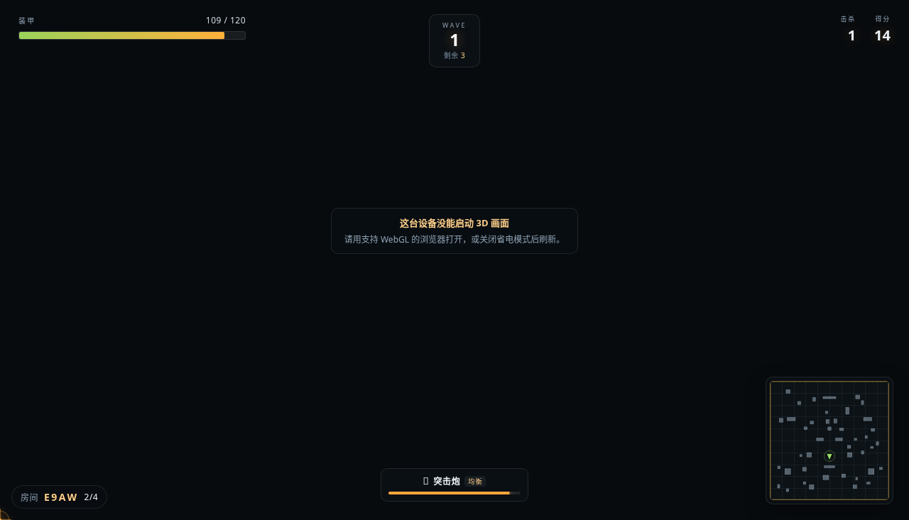
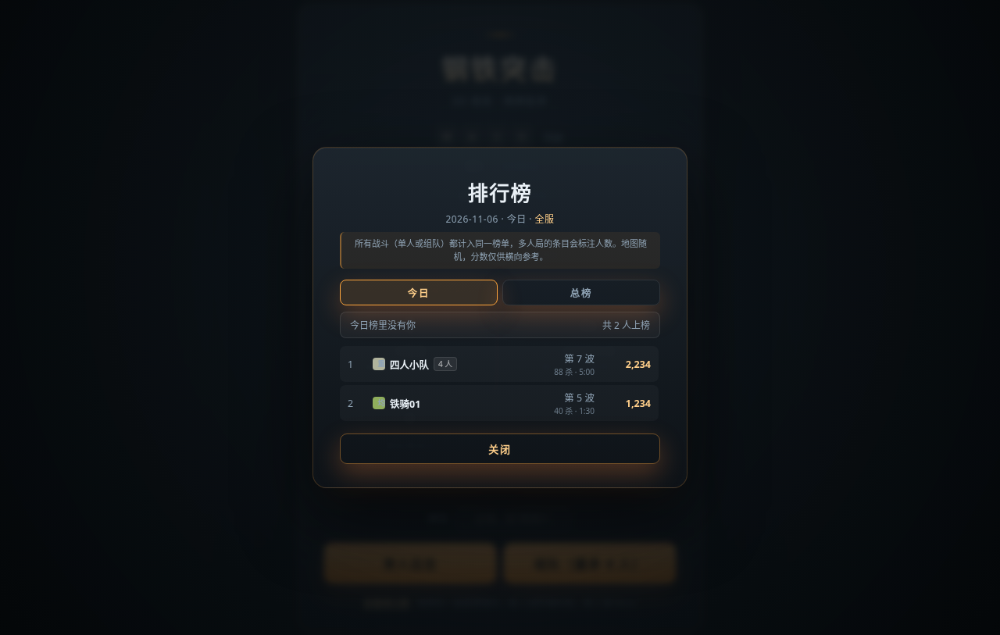

# 钢铁突击 · 3D 坦克肉鸽

浏览器里跑的 3D 坦克肉鸽生存游戏。纯静态、零依赖安装（Three.js r160 本地内置），
**每清完一波三选一强化**，每 3 波可换装新主炮，每 5 波迎战 Boss，死亡结束本局并记录最佳成绩。

- 本地：`node server.mjs` → http://localhost:5173（静态页 + 房间服务，一条命令全都有）
- 发布：见 [DEPLOY.md](./DEPLOY.md)（Cloudflare Pages 拖拽 / wrangler）

## 多人合作（最多 4 人）

1. 开局页先填呼号，点 **组队（最多 4 人）**；
2. 一个人点 **创建房间**，其余人凭 4 位房间码加入（链接里带 `?room=XXXX` 会自动填好）；
3. 房主可立即 **开始战斗**，否则 3 秒后自动开局；中途加入会拿到全量世界状态，直接参战。

规则与单人一致：同样的波次、敌人与掩体。人数越多，敌人血量按 `√n`、数量按 `n^0.85` 缩放，
分数也按 `√n` 加权，所以 4 人局的成绩与单人局在同一张榜上大致可比。

倒地不淘汰：血量归零变"倒地"，队友靠近 3 秒可拉起；30 秒没人救则进入复活倒计时（6 秒后满血 40% 回到战场）。

服务端权威 + 客户端预测：自己的坦克本地立刻响应，队友与敌人用 15Hz 快照插值，
即使 100ms 延迟操作也不粘手。快照二进制量化后约 220 字节/帧。

`npm start` 起的是一个完整环境：静态页 + 房间服务 + 榜单接口。
榜单规则和线上 Cloudflare Pages Functions 是**同一份代码**（`functions/api/_lib/leaderboard.js`），
本地只是把 KV 换成 `.data/scores.json`，所以本地打完就能在榜上看到自己。

```bash
npm start          # 起服务（默认 5173，PORT=8080 可改）
npm test           # 随机流 / 榜单 / 模拟，共 21 项
```

联机测试需要先起服务：`npm start` 后另开终端跑 `npm run test:net`（13 项，含本地榜单读写）。

页面放在纯静态托管（如 GitHub Pages）、房间服务跑在另一台机器时，用 `?ws=host:port` 指过去即可。

界面预览（来自本地自动化验证环境，该环境没有 WebGL，所以截图只验证了 HUD 与弹层布局，3D 画面需在本机查看）：

| 组队大厅 | 组队战场 HUD |
| --- | --- |
|  |  |

| 排行榜（今日 / 总榜） |
| --- |
|  |

## 操作

| 按键 | 作用 |
| --- | --- |
| `W` `A` `S` `D` / 方向键 | 驾驶（车体自动朝行进方向转向） |
| 鼠标移动 | 炮塔独立瞄准（跟随鼠标在地面的落点） |
| 鼠标左键 / `空格` | 开炮 |
| `Q` | 在已解锁的主炮之间切换 |
| `M` | 音效开/关 |
| `1`~`4` | 开始菜单选择车体 |
| `1` `2` `3` | 强化三选一 / 军械选择时快速选择 |

## 车体（开局选择）

| 车体 | 定位 | 装甲 | 移速 | 特性 | 外观 |
| --- | --- | --- | --- | --- | --- |
| 🎖 均衡型 | 标准 | 120 | 15 | 无，百搭 | 中型主战坦克：铸造八角炮塔、斜首上、侧裙、尾部格栅 |
| 🏍 轻装突击型 | 高速 | 90 | 19.5 | 低血高机动，玻璃大炮 | 低矮楔形车体、六角小炮塔、外露大直径负重轮、栅栏装甲 |
| 🛡 重装堡垒型 | 重甲 | 170 | 11.5 | 受到的伤害 -15% | 宽体厚甲、前部附加装甲块、全包厚侧裙、12.7 机枪塔 |
| 🏹 猎手型 | 续航 | 110 | 14 | 每次击毁敌人修复 3 点装甲 | 无炮塔歼击车：后置固定战斗室、超长身管、潜望镜与伪装沙袋 |

车体决定装甲/移速基础值与配色，并拥有**各自独立的 3D 造型**（车体轮廓、炮塔形状、主炮长度、行走机构均不同），与四门主炮自由组合；通用强化跨车体跨武器生效。

建模细节：负重轮随行驶里程滚动、斜首上装甲、侧裙、炮口制退器与抽气装置、车长塔/舱盖、高射机枪、天线、烟幕弹发射器、探照灯、尾部格栅与排气。玩家使用高细节档，敌方坦克使用低细节档（9 个网格/辆）以控制大量敌人时的 draw call。

## 战场与视角

- 战场 **200 × 200 米**（原 148 × 148），掩体按面积同步加密，波次敌人数量也随之补足，开阔但不空旷。
- **外围高墙已移除**，改为 0.8 米界桩 + 暗琥珀灯带：视线完全通透，边界依然清晰；外侧铺有大尺寸远景地面 + 雾，低视角下不会看到“地图断崖”。
- 相机俯角由 **48° 降到约 39°**（高度 26 / 后拉 31），更贴地，压迫感和临场感更强。
- 右下角**小地图**：障碍布局静态烘焙，实时叠加玩家朝向、全部敌人（精英 / Boss / 无人机 / 炮台 / 补给车 / 重盾兵独立配色）、炮击预警圈与刷怪落点。

## 挑战词条（每局随机 1 条）

| 词条 | 效果 | 补偿 |
| --- | --- | --- |
| 🌩 钢铁风暴 | 炮击间隔 7s → 4.5s | 得分 ×1.3 |
| 📦 弹药告急 | 全局射速 -20% | 清波奖励 ×1.5 |
| 🎯 精英猎场 | 每波必出精英 | 精英击破 +200 |
| 🌫 迷雾战场 | 视距减半 | 击杀得分 ×1.4 |
| ⚔ 军备竞赛 | 敌人血量 +30% | 军械补给改为每 2 波 |

词条显示在 HUD 顶部波次下方，开局提示 2.6 秒。

## 敌人图鉴

| 敌人 | 登场 | 行为 | 反制 |
| --- | --- | --- | --- |
| 步战车 | 第 1 波 | 标准 AI，保持距离对射 | 常规对炮 |
| 冲锋兵 | 第 2 波 | 高速贴脸自爆 16 伤害 | 保持距离点杀 |
| 精英坦克 | 第 3/8/13… 波（2~3 辆小队） | 高血高伤金色坦克 | 集火 |
| 自爆无人机 | 第 4 波起 | 低空飞行无视地形直扑，自爆 10 伤害 | 只能提前打掉 |
| 炮台 | 第 6 波起 | 固定不动，38m 远程重炮，开火前有瞄准线闪烁 | 借掩体接近拔点 |
| 补给车 | 第 7 波起 | 治疗 8m 内队友（+6/1.2s），被追会跑 | 优先击杀 +250 分 |
| 重盾兵 | 第 8 波起 | 正面 80% 减伤，背面无减伤 | 绕后攻击 |
| 破城者 / 棱镜 | 第 5/10/15/20 波 | Boss，见下文 | — |

## 排行榜

- **只有一条榜**：所有战斗（单人或 4 人合作）都计入，视图只有 **今日** 与 **总榜**（各 Top 100）。
- 地图与敌人每局随机，不要求"同一个种子才算公平"，分数只作横向参考；多人局的条目会标出人数。
- **呼号必填**：开局不填会就地提示并聚焦输入框（不弹窗），存 `localStorage` 下次自动带出。
- 结算上传成绩，显示 **今日 Top5 + 历史总榜 Top5**（自己的记录高亮），并写明「已上传全服 / 云端同步失败（原因）· 下次进入游戏会自动补传」。
- 榜单读取是 **云端 + 本地合并（同身份取最高）**：断网、KV 未绑定期间打的成绩不会因为云端返回空列表而消失。
- **去重按「呼号 + 本机 ID」**：不同玩家即使都叫「指挥官」也不会互相覆盖（早期按呼号去重，同名会互相顶掉）。
- 上传失败的成绩进入本地补传队列，下次进游戏静默重试；同一身份**只保留最高分**。
- 后端是 Cloudflare Pages Function（`functions/api/scores.js`）+ KV，规则写在 `functions/api/_lib/leaderboard.js`；
  本地 `node server.mjs` 用**同一份代码**、把 KV 换成 `.data/scores.json`，所以本地打完也能在榜上看到自己。
- 未绑定 KV 时线上自动回退浏览器本地排行，游戏功能不受影响。
- 服务端只接收当天（含昨天，容忍跨零点）的成绩，拒绝伪造历史战绩。
- 诊断：`/api/scores?view=stats` 可看今日榜 / 总榜的条数与最后写入时间。

## 音效

WebAudio 纯合成，零素材零依赖（`src/sound.js`）：开炮按武器类型分音色、爆炸按强度分级、
命中/受击/清波/过热/炮击预警/Boss 登场均有提示音。`M` 键静音，偏好存入 `localStorage`。

## 肉鸽玩法

- 每波敌人：数量 `2 + 波次 × 2`，血量 `55 + 波次 × 14`，速度随波次提升。
- 第 2 波起混入**冲锋兵**（体型更小、速度更快、近身自爆 16 伤害）。
- 清波奖励：`150 + 波次 × 25` 分，并修复 6 点装甲。
- 清波后进入**三选一强化**（按稀有度加权：常规 62 / 稀有 30 / 史诗 12）。
- 每 3 波（3/6/9/12…）的强化里必有一张**军械补给**，点击后从 3 门未解锁主炮中选一门换装。
- 已解锁的主炮可在战斗中按 `Q` 轮换；通用强化（伤害/射速/移速等）跨武器生效。
- 武器专属强化只会在**当前装备**那门主炮时进入卡池，换炮后专属改装仍保留。
- 强化可叠加，HUD 左上角显示已获得徽章与等级；满级后不再进入卡池。
- 死亡 → 结算面板（波次 / 击杀 / 得分 / 存活时间），`localStorage` 记录最佳成绩。

### 主炮

| 主炮 | 定位 | 单发伤害 | 射速 | 特点 |
| --- | --- | --- | --- | --- |
| 🎯 突击炮 | 均衡（初始） | 26 | 2.5 发/秒 | 弹速 68，中距离最稳 |
| 🔫 速射机炮 | 压制 | 11 | 9 发/秒 | 弹速 82，散布略大 |
| ⚡ 激光过热 | 爆发 | 30 | 3.3 发/秒 | 弹速 180，穿透 1；连续射击积热，过热后强制冷却 |
| 💣 榴弹炮 | 范围 | 64 | 1.25 发/秒 | 弹速 44，自带溅射（范围 ×1.25），专治集群 |

激光热量：每发 +7.5%，停火冷却 34%/秒，过热后 50%/秒 冷却到 0 才能再开火。

### Boss 与精英波

- **Boss 波**：第 5/10/15/20… 波，顶部出现 Boss 血条（含狂暴状态）。
  - 第 5/15 波 **破城者**：高血量重装坦克，三连重炮；定期发动攻城炮击（红圈 1.25 秒预警，18 伤害）。
  - 第 10/20 波 **棱镜**：高速能量坦克，三连速射；定期释放 12/16 发环形弹幕，并会相位跃迁换位。
  - Boss 血量低于 40% 进入**狂暴**：射速提升、技能间隔缩短。
- **精英波**：第 3/8/13/18… 波刷**精英小队**（2 辆，第 13 波起 3 辆）金色精英坦克错峰入场，单体血量约为普通坦克 4 倍、伤害 10，击破每辆额外 +450 分。
- Boss 击破额外获得 `1200 + 波次 × 80` 分。

### 反龟缩与刷怪规则

- 敌人有视线检测：玩家躲掩体后会调用 A* 绕到侧后方重新获得射界，不再站桩对射。
- **反龟缩压制**：波次进行中玩家持续不动（低于 30% 正常移速）约 3 秒即触发惩罚升级——
  立即一轮压制炮击、后续炮击间隔逐级缩短，2 级起刷冲锋兵（最高 3 级），恢复移动后快速解除。
- 刷怪点位于玩家 30~60 米的环形区域，且带 0.8 秒落点预警；预警到期生成前做硬校验：
  与玩家距离 <24 米（Boss 26 米）或与任何存活坦克 <9 米都会改点，杜绝贴脸刷。
- 第 2 波起，每波开始 18 秒后每隔 7 秒会炮击玩家脚边（1.6 秒红圈预警，22 伤害，半径 5 米），逼迫走位。

### 强化列表

| 强化 | 稀有度 | 效果 | 上限 |
| --- | --- | --- | --- |
| 💥 火力强化 | 常规 | 伤害 +22% | 5 |
| ⚡ 快速装填 | 常规 | 射速 +18% | 4 |
| 🛞 涡轮增压 | 常规 | 移速 +12% | 4 |
| 🛡 复合装甲 | 常规 | 装甲上限 +25 并修复 25 | 5 |
| 🔧 战地维修 | 常规 | 立即修复 45 | — |
| 🔫 双联炮组 | 稀有 | 每次开炮 +1 发（带散布） | 2 |
| 🎯 穿甲弹芯 | 稀有 | 子弹可多穿透 1 辆坦克 | 2 |
| 💣 高爆弹头 | 稀有 | 命中溅射 30×等级 伤害（半径 4.2） | 2 |
| 🚀 电磁轨道 | 史诗 | 弹速 +35%，伤害 +12% | 2 |
| 🔥 过载核心 | 史诗 | 伤害 +35%，射速 +20% | 1 |
| 💠 反应装甲 | 稀有 | 受到的伤害 -12% | 2 |
| 🧬 纳米修复 | 常规 | 每波清除额外修复 12 点装甲 | 3 |
| 🏰 壁垒协议 | 史诗 | 受到的伤害 -22%，移动速度 -5% | 1 |

### 武器专属强化

装备对应主炮时才会出现在卡池里。

| 强化 | 武器 | 稀有度 | 效果 | 上限 |
| --- | --- | --- | --- | --- |
| 🛠 炮口制退器 | 突击炮 | 常规 | 射速 +12%，伤害 +8% | 2 |
| 🎯 钨芯穿甲弹 | 突击炮 | 稀有 | 穿透 +1，弹速 +15% | 2 |
| ❄ 枪管散热器 | 速射机炮 | 稀有 | 射速 +18%，散布 -20% | 2 |
| 🔗 穿甲弹链 | 速射机炮 | 史诗 | 伤害 +25%，穿透 +1 | 1 |
| ❄ 超导冷却 | 激光 | 稀有 | 热量增长 -22%，冷却 +25% | 2 |
| 🔍 聚焦透镜 | 激光 | 史诗 | 伤害 +30%，穿透 +1 | 1 |
| 💥 高爆装药 | 榴弹炮 | 稀有 | 爆炸范围 +20%，溅射伤害 +30% | 2 |
| ⚙ 自动装填机 | 榴弹炮 | 稀有 | 射速 +15%，弹速 +10% | 2 |

## 目录结构

```
roguetank/
├─ index.html          开始界面 / HUD / Boss 血条 / 强化三选一 / 组队大厅 / 结算 DOM
├─ styles.css          暗色 + 琥珀金 UI，稀有色光卡片
├─ build.mjs           生成可部署的 dist/
├─ package.json        npm scripts（start / test / build）
├─ .gitignore          忽略 dist、node_modules、wrangler 缓存
├─ .github/workflows/  GitHub Actions 自动部署到 Cloudflare Pages
├─ DEPLOY.md           Cloudflare Pages 部署说明（含 GitHub 自动部署）
├─ server.mjs          本地/自建服务器：静态文件 + /ws 房间服务 + /api/scores
├─ server/room.js      房间逻辑（成员、30Hz tick、快照广播）
├─ server/score-store.js  本地榜单存储（KV 的文件版替身）
├─ functions/api/scores.js  Cloudflare Pages Function 适配层
├─ functions/api/_lib/leaderboard.js  榜单规则（线上 KV 与本地文件共用一份）
├─ test/               纯 Node 测试（随机流 / 榜单 / 模拟 / 联机端到端）
├─ docs/ARCHITECTURE.md 架构演进与联机方案
├─ vendor/three.module.js
└─ src/
   ├─ main.js          入口
   ├─ rng.js           命名随机流（spawn / combat / fx 互不干扰）
   ├─ net.js           联机客户端（预测 + 插值）
   ├─ coop.js          多人合作模式的渲染与输入
   ├─ Game.js          主循环、输入、战斗、波次/Boss/精英、肉鸽流程、军械与热量
   ├─ chassis.js       车体定义（装甲/移速/特性/配色）
   ├─ modifiers.js     挑战词条（每局随机全局规则）
   ├─ sound.js         WebAudio 合成音效（M 键静音）
   ├─ daily.js         成绩上传 + 今日榜/总榜拉取（失败自动存本机补传）
   ├─ core/world.js    与服务端共享的权威模拟（不依赖 three，Node 与浏览器同跑）
   ├─ core/players.js  玩家状态 / 倒地救援 / 人数缩放
   ├─ core/protocol.js 协议版本、消息类型、快照编解码
   ├─ upgrades.js      通用强化 / 倍率属性 / 加权抽卡 / 军械卡
   ├─ weapons.js       四门主炮数据 / 武器专属强化 / 实际数值结算
   ├─ Tank.js          坦克模型与移动/炮塔逻辑
   ├─ Enemy.js         敌人 AI（视线检测 / A* 绕后 / 冲锋兵 / 精英 / Boss 技能）
   ├─ Bullet.js        子弹（彩色 / 穿透 / 溅射参数）
   ├─ Effects.js       粒子与爆炸特效
   ├─ level.js         200m 地图生成 + 碰撞 / 线段遮挡查询
   ├─ nav.js           2 米网格 A* 导航与路径平滑
   ├─ minimap.js       小地图渲染（静态障碍烘焙 + 动态图层）
   └─ HUD.js           DOM HUD、Boss 血条、强化/军械面板、武器与热量、受击红晕

PVE 玩法后续规划见 [docs/PVE_DESIGN.md](./docs/PVE_DESIGN.md)。
```

## 开发与打包

```powershell
cd tank3d-p0
npm run dev         # 本地开发 http://localhost:5173
npm run build       # 生成 dist/（发布用）
```

> 不能直接用 `file://` 打开 `index.html`（ES Module 跨域限制）。

## 发布

推荐 GitHub + Cloudflare Pages 自动部署：推送到 `main` 即自动构建上线。

- 面板能连接 GitHub：按 [DEPLOY.md](./DEPLOY.md) 的 Pages Git 集成配置。
- 面板连不上 GitHub：仓库已内置 `.github/workflows/deploy.yml`，配好两个 Secrets 后由 GitHub Actions 自动部署。

完整步骤见 [DEPLOY.md](./DEPLOY.md)。

## 后续可做

- 音效 / 背景音乐
- 永久性 meta 进度（局外解锁、初始强化）
- 观战 / 回放
- 组队局内也能三选一强化（目前为保证可比性，固定用突击炮）
- 更精细的程序化坦克建模（斜面装甲 / 负重轮 / 履带滚动）
- 手机触控（虚拟摇杆 + 开火键 + 竖屏适配）
- 低端机性能分级（关阴影、降分辨率）

## 迁 Cocos 发布抖音小游戏（对照）

| 本原型 | Cocos Creator 3.8 |
| --- | --- |
| `THREE.Group/Mesh` + 基础几何体 | `Node` + `MeshRenderer`，换低模 glTF |
| `Game.update(dt)` | 场景根节点 `GameManager` 组件的 `update` |
| `Bullet` / `Effects` 数组 | `NodePool` 对象池复用 |
| `Tank.js` 移动与瞄准 | 直接搬成 `TankController` 组件 |
| `Enemy.js` 状态机 | `EnemyAI` 组件 |
| `level.js` AABB 碰撞 | 保留手写碰撞（比物理引擎省） |
| DOM HUD | Cocos UI（Widget + Label + Sprite） |
| 键鼠输入 | `input.on(TOUCH_*)` + 虚拟摇杆 |
| 强化系统 `upgrades.js` | 纯数据 + 纯函数，原样复用 |

抖音侧硬性约束：主包 ≤ 4MB、竖屏 + 安全区、低端机关阴影、资源走 `assetBundle`。
