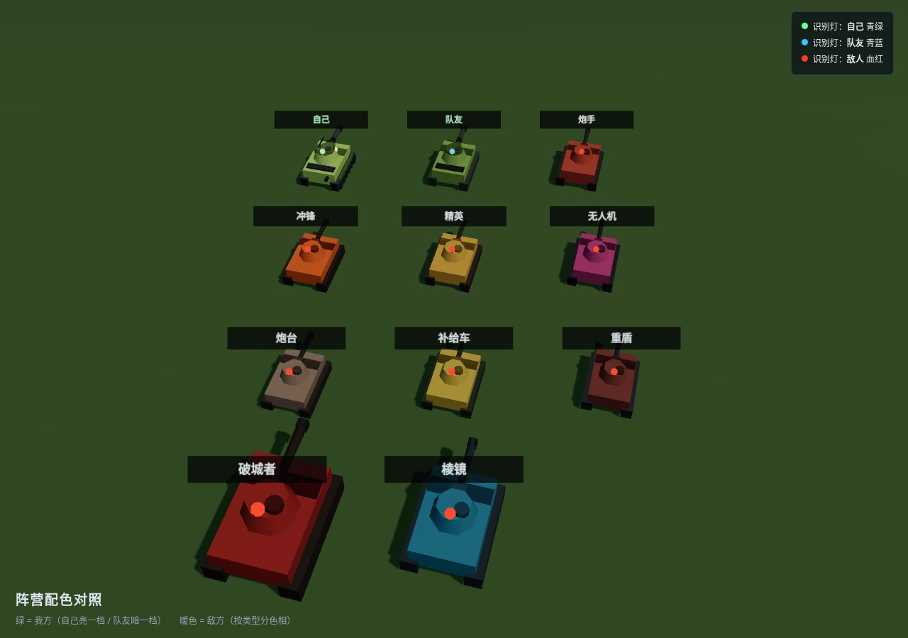
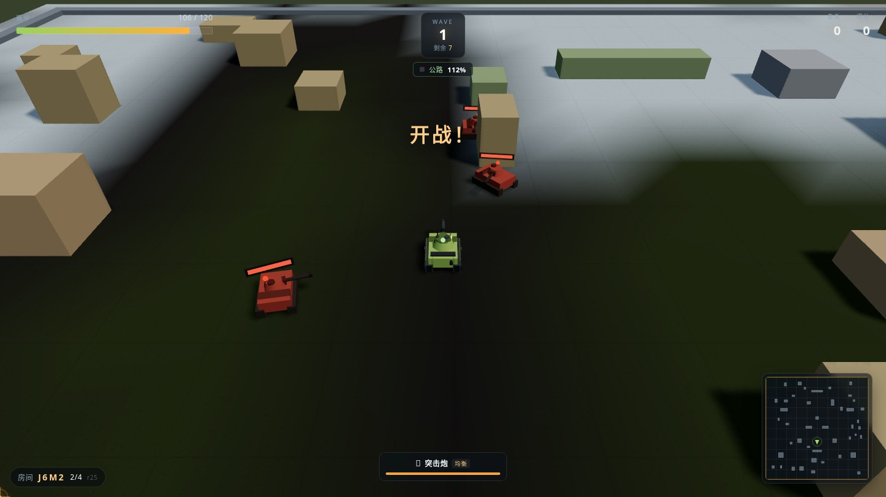
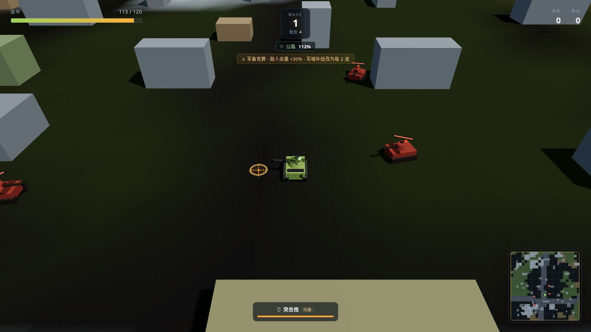

# 25 版说明（r25）

修的是你报的那条：**敌方坦克和我方坦克颜色一样，都是绿的**。

在组队模式里这不是"色调接近"，是真的同一个颜色值 —— 代码里根本没有给联机的
坦克传颜色，全部落到 `0x5f7a3c` 这个默认值上。玩家、队友、敌人、BOSS，一整场
十几辆绿车，只能靠头顶血条猜谁是谁。

---

## 一、根因

`Tank` 的构造函数里颜色是这么取的：

```js
body: opts.body ?? 0x5f7a3c,   // 缺省绿
```

单机这边传了颜色：玩家传车体表的军绿，敌人按类型传红/橙/金/紫。
但联机的三处 `new Tank` **一个参数都没传**：

| 位置 | 谁 | 旧行为 |
|---|---|---|
| `coop.js` 进房建自己的车 | 玩家 | 缺省绿 `0x5f7a3c` |
| `coop.js` `_addMate` | 队友 | 缺省绿 `0x5f7a3c` |
| `coop.js` `_upsertEnemy` | 敌人 | 缺省绿 `0x5f7a3c` |

三个不同阵营走同一个默认值，等于没有配色。单机虽然整体是对的，但也有两处
和自己撞色：补给车是绿的（`0x4f8f5f`）、炮台是灰绿的（`0x77806b`）——
玩家会朝补给车开火，或者对炮台放松警惕。

---

## 二、改法

核心不是"把敌人的颜色改红"，而是**让颜色只有一个来源**。以前是三个文件各写
一份，改一个忘两个，才会出现"单机是对的、联机全绿"。

| 位置 | 改动 |
|---|---|
| `src/teams.js`（新增） | 唯一色板：自己 / 队友 / 敌方七类 + BOSS，外加 `tankSkin()` 合并逻辑 |
| `src/Tank.js` | 缺省色改成按 `team` 取阵营色 —— **漏传也不会变成绿**；炮塔顶加阵营识别灯 |
| `src/coop.js` | 自己传 `SELF_SKIN`、队友传 `MATE_SKIN`、敌人按 `type` 传 `enemySkin()` |
| `src/Enemy.js` | 单机敌人改用同一张表（补给车、炮台不再撞色） |
| `src/minimap.js` | 小地图的补给车、重盾改成暖色，和车体一致 |
| `test/teamcolor.test.mjs`（新增） | 30 项断言锁住"绿=我方、暖色=敌方"，防止又有人把某个敌人调绿 |

### 配色约定

| 阵营 | 车体 | 识别灯 |
|---|---|---|
| 自己 | 军绿 `#8fae5c`（取车体表，和车库里那辆一致） | 青绿 `#6bff9a` |
| 队友 | 暗一档军绿 `#6f8f4a` | 青蓝 `#37c8ff` |
| 敌人 | 暖色系：炮手铁锈红 / 冲锋橙 / 精英金铜 / 无人机品红 / 炮台灰褐 / 补给沙黄 / 重盾暗红棕 | 血红 `#ff3b26` |
| BOSS | 破城者深绯、棱镜冷青 | 血红 |

两条原则：

1. **绿 = 我方，暖色 = 敌方**。这是最不需要学习成本的约定，也不和地形撞色
   （草是深绿，我方车更亮更黄，敌方全在红橙黄区间）。
2. **灯比车体更可靠**。车体色受光照、阴影、雾影响，炮塔顶那颗灯是
   `MeshBasicMaterial`（不吃光照），远距离就是一个纯色点。

> 第一版识别灯用的是高 `emissive` 的 Standard 材质，`emissiveIntensity: 1.6`
> 经过 ACES 色调映射后**敌我双方都饱和成白点** —— 实测截图才发现，等于白做。
> 现在改成 Basic 材质，颜色就是色板里的值。

---

## 三、效果

配色对照（自己 / 队友 / 敌方七类 / 两个 BOSS）：



组队实拍（中间绿车是自己，两侧是被打成红色的敌人）：



单机实拍（自己绿车，敌人红车，小地图点同步）：



---

## 四、兼容性

- **纯客户端表现层**，协议一字未改，服务端不参与配色。
- 只更新前端（`src/`）即可生效；服务端不重启也没关系。
- 旧客户端连新服务端、新客户端连旧服务端，都照常跑，只是旧客户端看不到新配色。
- `BUILD` r24 → r25，左上角版本自检会提示刷新。

---

## 五、文件清单

```
新增
  src/teams.js                 阵营色板（唯一来源）
  test/teamcolor.test.mjs      30 项配色断言
  docs/teamcolor-board.html    配色对照页（截图用，不进发布包）
  docs/shots/*.png             效果图

修改
  src/Tank.js                  缺省色按 team 取 + 炮塔识别灯
  src/coop.js                  三处建车传阵营色
  src/Enemy.js                 单机敌人改用共用色板
  src/minimap.js               补给车/重盾的小地图颜色
  src/core/protocol.js         BUILD → r25
  package.json                 test 链加 teamcolor
```

---

## 六、验证

1. `npm test` 全绿（新增的 30 项配色断言 + 原有 18 个测试文件）。
2. 两个客户端进同一房间打第一波，读场景内的实际配色：
   自己 `#8fae5c`/青绿灯、队友 `#6f8f4a`/青蓝灯、敌人 `#9c4436`/红灯。
3. 单机跑一波，敌人 `#9c4436`，玩家 `#8fae5c`，小地图点同色系。
4. 反向验证：把色板里 `support` 改回旧的绿 `0x4f8f5f`，测试立刻报
   「敌人 support 不是绿色」失败。
