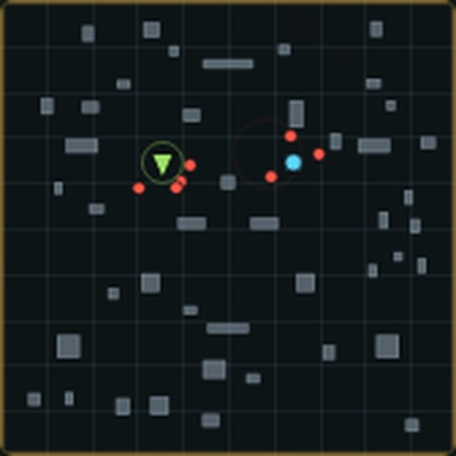

# 26 版说明（r26）

修的是你报的这条：**多人模式车辆跑起来后，画面一顿一顿地晃**。

先说清楚它和上一个 bug 的区别：13~19 版修的是"抖"——车体位置在帧间乱跳；
这次是"晃"——车体本身是平滑的，**相机**自己在动。所以预测层怎么调都没用，
问题在相机那一行公式上。

---

## 一、根因：相机的滞后量不是常数

组队和单机的相机都是同一个写法：

```js
cam.x += (tank.x - cam.x) * (1 - Math.exp(-7.5 * dt));   // 纯比例低通
```

这是比例控制，匀速行驶时必然留下**稳态误差**：

> 滞后 = 速度 / 系数 = 15 / 7.5 = **2 米**

车在屏幕中心，画面"领先"两米是常态，玩家不会察觉。问题在于**这个两米会变**：

| 场景 | 速度 | 相机滞后 |
|---|---|---|
| 草地 | 15 | 2.00 米 |
| 公路 | 16.8 | 2.24 米 |
| 雪地 | 11.4 | 1.52 米 |
| 沼泽 | 8.25 | 1.10 米 |
| 撞墙急停 | 0 | 0 米 |

每跨过一条地表边界，整屏就推拉一次。一张图上是反复的沙地、公路、沼泽，
于是"一顿一顿地晃"。

而 `camLook`（视线目标）也是低通，相机跑在前、目标落在后，两者始终差着这同一个
两米——**俯角跟着变**：

```
俯角 = atan(26 / (31 + 2.0)) ≈ 38.3°   →   atan(26 / 31) = 40.0°
```

一辆车跑过一片公路或沼泽，整屏俯角就摆动 1~2 度。人对"整屏俯仰"极其敏感，
这就是你感觉到的"晃"而不是"抖"。

> 组队里还多一层：车体位置是 30Hz tick 插值出来的，相机低通再去追它，
> 等于两级滞后串联，滞后量的波动比单机更明显。

---

## 二、改法：速度前馈 + 位置纠偏 + 视线钉在车体上

`src/core/camera.js`（新增）是相机跟随的**唯一实现**，单机和组队都调它。

1. **速度前馈**：每帧先把相机按车体速度推同样一段 → 稳态误差直接归零。
   变速时也不留"要追的差值"，所以公路/沼泽切换不再推拉。
2. **位置纠偏**：只处理剩下真出错的部分（撞墙、传送、残差消化），
   平时恒等于 0。
3. **纠偏速率限幅**：传送/复活时相机是匀滑追过去，不会抽一下。
4. **视线目标 = 车体位置**，不做低通 → 俯角恒定为 atan(26/31)，彻底不俯仰。
5. **震屏仍然只平移不旋转**（这条 24 版已经修好，保持）。

| 位置 | 改动 |
|---|---|
| `src/core/camera.js`（新增） | `followStep()` / `validateFollow()`，纯数字、可在 Node 里测 |
| `src/Game.js` | `_updateCamera` 改调 `followStep`，相机改为"实测速度"前馈 |
| `src/coop.js` | 同上；进房时把 `_vel` 清零，避免第一帧从单机镜头滑过来 |
| `test/camerafollow.test.mjs`（新增） | 19 项断言 |

### 量化效果

| 场景 | 旧算法 | 新算法 |
|---|---|---|
| 匀速直行，相机与车距离 | 2.00 米（且随速度变） | **恒为 31 米，误差 < 1cm** |
| 公路↔沼泽来回切换的摆动 | **1.06 米** | **< 2cm** |
| 撞墙急停 | 滞后 2 米被"追回来" | 原位不动 |
| 相机每帧位移 vs 车体 | 忽快忽慢 | 逐帧一致（sd < 1mm） |
| 俯角 | 38.2°~40.0° 摆动 | 恒定 40.0° |

测试里的"对照"项专门用旧算法跑一遍同样的场景，确认它在新算法下会失败 ——
防止哪天有人"顺手"把相机改回低通。

---

## 三、顺手补的两件事

### 1. 组队模式一直没有小地图

`#minimap` 这个 canvas 一直在页面上，单机每 80ms 刷一次，**组队却从来没画过**。
四个人找敌人全靠肉眼，也不知道队友在哪。现在组队也画：



- 绿三角 = 自己，**青蓝点 = 队友**（新）
- 红点按敌人类型上色，精英/头目带光圈
- 近处朝我方飞的炮弹是小橙点
- 有敌人开火时闪一下红圈（见下）

### 2. "敌人在开火"现在能看见了

上一轮查破坏者主炮时发现的：敌人开炮**没有炮口火光**（只有玩家有）、
**没有音效**、**屏幕不震**。它在打你，而你完全看不出来。

现在服务端每次敌人开火推一条 `eshot` 事件（只带 id，约 20 字节），
客户端在小地图对应位置闪一圈红。这是成本最低的"我被人瞄着"提示。

> 真正的炮口火光/音效属于表现层增强，需要你确认方向（见上一轮的 A/B/C 方案），
> 这次先补了不会影响手感和性能的那一半。

---

## 四、兼容性

- **协议只加不减**：`eshot` 是新增事件类型，旧客户端收到会走 `default` 忽略，
  新客户端连旧服务端只是没有红圈提示。`PROTOCOL_VERSION` 不变（仍是 3）。
- 相机改动纯客户端，服务端不需要动。
- `BUILD` r25 → r26。

---

## 五、文件清单

```
新增
  src/core/camera.js            相机跟随唯一实现
  test/camerafollow.test.mjs    19 项
  test/coopminimap.test.mjs     7 项（eshot 事件 + 小地图绘制）
  docs/shots/minimap-coop.jpg   组队小地图实拍

修改
  src/Game.js                   单机相机改走 followStep
  src/coop.js                   组队相机改走 followStep + 组队小地图
  src/minimap.js                队友点 / 来袭炮弹 / 开火脉冲；DPR 兼容 Node
  src/core/world.js             敌人开火推 eshot
  src/core/protocol.js          BUILD → r26
  package.json                  测试链加两项
```

---

## 六、验证

1. `npm test` 全绿（新增 26 项）。
2. 组队两个客户端进房打一波：小地图能看到自己的绿三角、队友的青蓝点、
   七个红点敌人；有敌人开火时红圈闪一下（实测 `pulses: 4`）。
3. 两个模式的相机都没有 NaN、进房第一帧不滑镜头。
4. 反向验证：把 `_updateCamera` 改回低通，`camerafollow` 的对照项立刻失败。
